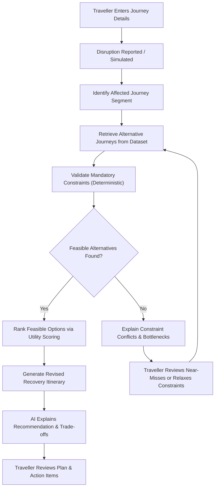
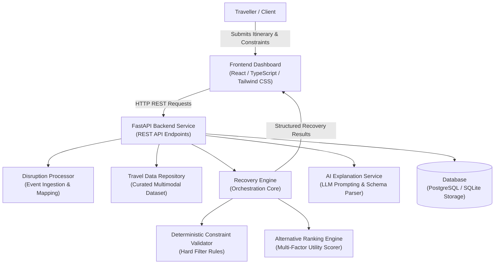
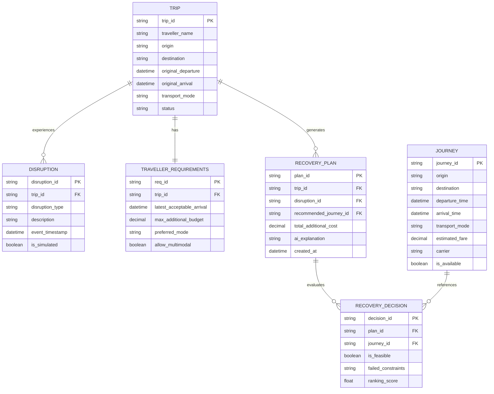
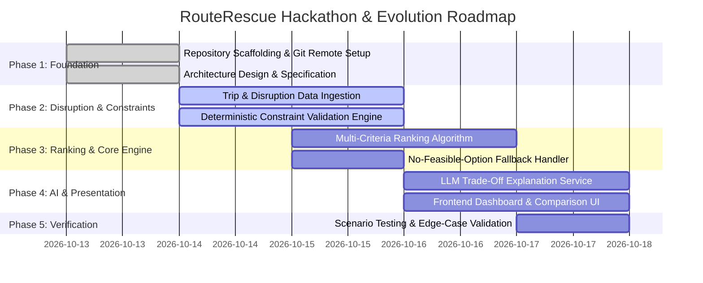

# RouteRescue

> **When Travel Plans Fall Apart, Your Journey Doesn't Have To.**

[](#hackathon-information)
[](#problem-statement)
[](#project-status)

---

## Table of Contents

1. [Project Overview](#1-project-overview)
2. [The Problem We Are Solving](#2-the-problem-we-are-solving)
3. [Project Objectives](#3-project-objectives)
4. [Target Users](#4-target-users)
5. [Core Features](#5-core-features)
6. [End-to-End System Workflow](#6-end-to-end-system-workflow)
7. [Technical Architecture](#7-technical-architecture)
8. [Data Model](#8-data-model)
9. [API Design](#9-api-design)
10. [Implementation Plan & Roadmap](#10-implementation-plan--roadmap)
11. [Testing and Evaluation](#11-testing-and-evaluation)
12. [Sample Demonstration Scenario](#12-sample-demonstration-scenario)
13. [Business Model](#13-business-model)
14. [Scalability and Future Roadmap](#14-scalability-and-future-roadmap)
15. [Security, Privacy, and Reliability](#15-security-privacy-and-reliability)
16. [Project Structure](#16-project-structure)
17. [Installation and Local Setup](#17-installation-and-local-setup)
18. [Environment Variables](#18-environment-variables)
19. [Limitations](#19-limitations)
20. [Contributing](#20-contributing)
21. [License](#21-license)
22. [Team & Hackathon Information](#22-team--hackathon-information)

---

## 1. Project Overview

**RouteRescue** is an AI-powered travel disruption recovery platform built to assist travellers when unexpected events derange their travel schedules. 

When a flight is delayed or cancelled, or a connecting link is missed, passengers are routinely plunged into high-stress manual recalculations. Unlike conventional conversational chatbots that merely suggest tourist attractions or search single travel legs without constraint validation, RouteRescue treats travel disruption recovery as a **constrained multi-factor decision problem**.

The recovery engine systematically evaluates alternative itineraries against critical traveller requirements, including:
- **Origin and Destination**: Required departure point and arrival terminal.
- **Dates and Permitted Travel Window**: Earliest departure time and latest acceptable arrival deadline.
- **Financial Bounds**: Strict ceiling on maximum additional out-of-pocket expenditure.
- **Travel Modalities**: Acceptable transport modes (flight, high-speed train, intercity bus, express cab).
- **Traveller Preferences**: Soft preferences such as preferred airline alliance, non-stop routes, or transport mode.
- **Itinerary Continuity**: Ensuring downstream hotel check-ins or critical appointments remain viable.

### The MVP Scope
For the DevHost 2026 36-hour hackathon prototype, RouteRescue operates with a **curated multimodal travel dataset** and **simulated disruption events**. It performs deterministic constraint validation to separate feasible from infeasible options, ranks valid options using a weighted multi-criteria utility formula, and utilizes an AI service to summarize trade-offs in plain language. Live booking system mutations and live airline GDS integrations are deliberately reserved for future production phases.

---

## 2. The Problem We Are Solving

Travel disruptions create compound operational and psychological friction:

1. **Fragmentation Across Platforms**: Following a cancellation, travellers must juggle multiple booking apps, airline help desks, train schedules, and aggregators under severe time pressure.
2. **Hidden Infeasibility in "Cheapest" Options**: The least expensive replacement ticket often arrives hours or days after an indispensable business meeting, wedding, or event deadline, rendering it useless.
3. **Budget and Preference Conflicts**: Rapidly rebooked alternatives frequently violate personal expenditure ceilings or force undesirable transit modes without clear warnings.
4. **Cognitive Overload Under Stress**: Travellers in noisy airports are forced to calculate time-zone differences, layover durations, and transfer feasibility in their heads.
5. **Cascading Itinerary Failures**: A single disrupted flight segment can jeopardize hotel reservations, rental cars, and connecting journeys across the entire trip.

> **Realistic Boundary**: RouteRescue does not claim to eliminate travel delays or guarantee transport availability during widespread network meltdowns. Instead, it consolidates search, verification, and recovery planning into a transparent, dependable workflow.

---

## 3. Project Objectives

- **Simplify Disruption Recovery**: Centralize alternative discovery into a single coherent interface.
- **Eliminate Manual Cross-Checking**: Programmatically cross-examine schedules, transit times, and budgets.
- **Deterministic Constraint Enforcement**: Strictly reject alternatives violating mandatory conditions (e.g., arrival deadline exceeded or budget exceeded).
- **Intelligent Preference-Based Ranking**: Prioritize surviving feasible journeys based on user priorities.
- **Explainable Recommendations**: Clarify *why* an alternative is recommended over other candidates.
- **Consolidated Recovery Itinerary**: Produce a complete, actionable recovery plan showing original vs. revised journeys.
- **Actionable Decision Support**: Help travellers review options and understand exactly what steps to take.
- **Architectural Foundation**: Provide clean APIs and data models ready to interface with live travel distribution APIs in future stages.

---

## 4. Target Users

*(Identified intended user groups; not claiming current commercial deployment)*

- **Individual Leisure Travellers**: Travellers caught in unexpected cancellations who need rapid, clear recovery options without navigating multiple aggregator websites.
- **Time-Sensitive Business Travellers**: Professionals with strict arrival deadlines for meetings, conferences, or speaking engagements where arriving late is unacceptable.
- **Corporate Travel Managers**: Internal operations teams coordinating logistics and budget approvals for stranded employees across different regions.
- **Travel Agencies & TMCs (Travel Management Companies)**: Support agents seeking instant, constraint-checked recommendations to resolve customer inquiries faster.

---

## 5. Core Features

### Module 1: Trip Input and Traveller Constraints
Collects travel parameters and cleanly decouples **mandatory constraints** from **soft preferences**:
- **Mandatory Constraints (Hard Filters)**:
  - Final destination required.
  - Latest acceptable arrival time (deadline).
  - Maximum additional budget limit.
  - Required departure date window.
- **Soft Preferences (Ranking Weights)**:
  - Preferred transport mode (e.g., flight over rail).
  - Maximum acceptable number of stops/transfers.
  - Cost sensitivity vs. speed priority.

### Module 2: Disruption Management
Simulates and tracks disruption events associated with specific journey segments:
- **Disruption Types**: Flight cancellation, prolonged flight delay, missed connection.
- **Event Metadata**: Affected segment ID, reported timestamp, delay duration, and cancellation reason.
- **Simulation Transparency**: Explicitly tags events as *simulated* for hackathon demonstration.

### Module 3: Alternative Journey Search
Queries candidate alternatives from the curated travel repository:
- **Journey Model**: `journey_id`, `origin`, `destination`, `departure_time`, `arrival_time`, `mode`, `estimated_fare`, `duration_minutes`, and `availability_status`.
- Supports multimodal alternatives across regional corridors.

### Module 4: Constraint Validation Engine *(Core Module)*
Performs 100% deterministic validation logic in backend Python code without relying on probabilistic LLM guesses:
- **Arrival Deadline Check**: Disqualifies any candidate where `arrival_time > latest_acceptable_arrival_time`.
- **Budget Ceiling Check**: Disqualifies any candidate where `additional_fare > max_additional_budget`.
- **Destination Verification**: Rejects any route that does not terminate at the designated destination.
- **Availability Check**: Rejects any itinerary marked as unavailable or sold out.
- **Zero Silent Relaxation**: Constraints are never relaxed automatically. If no journey passes, the system enters the No-Feasible-Option routine.

### Module 5: Alternative Ranking
Applies a transparent multi-criteria scoring algorithm across only the candidates that passed all mandatory constraints:

$$\text{Score} = w_{\text{cost}} \cdot S_{\text{cost}} + w_{\text{time}} \cdot S_{\text{time}} + w_{\text{duration}} \cdot S_{\text{duration}} + w_{\text{mode}} \cdot S_{\text{mode}}$$

Where:
- $S_{\text{cost}} = 1 - \frac{\text{additional\_cost}}{\text{max\_additional\_budget}}$
- $S_{\text{time}} = \frac{\text{deadline} - \text{arrival\_time}}{\text{deadline} - \text{earliest\_departure}}$
- Normalized values are weighted based on the traveller's stated preference profile (e.g., *Speed Priority* vs *Budget Priority*).

### Module 6: AI-Assisted Interpretation
An LLM integration provides human-friendly synthesis without compromising mathematical correctness:
- **Natural Language Parsing**: Extracts origin, destination, and constraints from freeform user queries.
- **Trade-Off Summarization**: Explains why Option A is recommended over Option B (e.g., *"Option A arrives 45 minutes before your meeting for an extra ₹1,200, whereas Option B arrives with zero buffer"*).
- **Architectural Guardrail**: The LLM is **never** the authority on constraint feasibility. If the LLM service is offline or errors, the deterministic recovery engine continues functioning seamlessly.

### Module 7: Recovery Itinerary Generation
Assembles a complete recovery dossier:
- Summary of original disrupted segment.
- Recommended replacement journey with exact schedule and carrier details.
- Comprehensive cost breakdown and trade-off audit.
- Specific manual actions required (e.g., *"Request airline refund for Leg 1; book Train 12050 on IRCTC"*).
- *Explicit disclaimer*: Clearly flags that rebookings are recommendations, not executed transactions.

### Module 8: Recovery Dashboard
Presents an accessible visual breakdown:
- Disrupted leg banner with status and impact.
- Side-by-side comparison cards of evaluated alternatives.
- Visual badge indicators: `FEASIBLE`, `DEADLINE EXCEEDED`, `OVER BUDGET`.
- Recommended itinerary highlight.

### Module 9: No-Feasible-Option Handling
When all candidates fail mandatory constraints:
- Clear failure notification identifying the specific bottleneck(s) (e.g., *"No available journeys arrive before 08:00 AM within ₹5,000"*).
- Displays near-miss options with explicit violation warnings.
- Prompts the user with structured relaxation sliders (e.g., increase budget by ₹1,500 or extend deadline by 2 hours).

---

## 6. End-to-End System Workflow



### Step-by-Step Execution Lifecycle
1. **Step 1 — Input Capture**: Traveller records origin, destination, scheduled times, deadline, and maximum budget.
2. **Step 2 — Disruption Ingestion**: A disruption event (e.g., flight cancellation) is registered or simulated.
3. **Step 3 — Impact Identification**: The system maps the disruption to the relevant journey segment.
4. **Step 4 — Candidate Query**: The repository retrieves all potential alternate journeys matching origin and destination.
5. **Step 5 — Deterministic Filtering**: The Constraint Engine tests arrival deadlines, budget ceilings, and seat availability.
6. **Step 6 — Exclusion**: Non-compliant routes are marked with specific violation flags and excluded from ranking.
7. **Step 7 — Multi-Criteria Ranking**: Compliant options are scored against traveler weights (time vs cost vs mode).
8. **Step 8 — AI Narrative Generation**: The LLM creates a concise narrative explaining the rationale and trade-offs.
9. **Step 9 — Itinerary Assembly**: The final revised itinerary is generated with step-by-step traveler advisories.
10. **Step 10 — Traveller Review**: The traveler inspects the recovery plan, trade-offs, and takes rebooking actions.

---

## 7. Technical Architecture



### Component Responsibilities

| Component | Technology | Primary Responsibilities |
| :--- | :--- | :--- |
| **Frontend** | React / TypeScript / Tailwind CSS | Collect traveller constraints, display disruption alerts, render side-by-side alternative comparison cards, and display revised recovery itinerary. |
| **Backend API** | Python / FastAPI | Validate incoming request schemas, execute disruption mapping, coordinate data lookup, run deterministic validation, and handle error responses. |
| **Recovery Engine** | Python Core Logic | Pure deterministic evaluation of mandatory constraints (deadlines, budgets, availability) and mathematical scoring for ranking. |
| **Travel Data Repo**| In-memory / CSV / SQL | Curated collection of multimodal transit routes (air, rail, road) with realistic timetables and fares. |
| **AI Explanation** | OpenAI / Gemini API (or Mock) | Generates plain-English explanations of recommendation trade-offs. Operates as an augmentation layer with strict schema validation. |
| **Storage Layer** | PostgreSQL / SQLite | Persists trips, traveller constraints, simulated disruption logs, and recovery plans. |

---

## 8. Data Model

The proposed data model specifies the relational structure for RouteRescue:



---

## 9. API Design

The backend implements or specifies the following RESTful API endpoints:

### 1. Trip Management
- **`POST /api/trips`**
  - **Purpose**: Register an original journey and traveller constraints.
  - **Request Body**:
    ```json
    {
      "traveller_name": "Aman Jain",
      "origin": "BLR",
      "destination": "DEL",
      "original_departure": "2026-10-15T06:00:00Z",
      "original_arrival": "2026-10-15T08:45:00Z",
      "transport_mode": "flight",
      "latest_acceptable_arrival": "2026-10-15T12:00:00Z",
      "max_additional_budget": 5000.00,
      "preferred_mode": "flight"
    }
    ```
  - **Response `201 Created`**:
    ```json
    {
      "trip_id": "trip_blr_del_01",
      "status": "SCHEDULED",
      "created_at": "2026-10-13T22:40:00Z"
    }
    ```

- **`GET /api/trips/{trip_id}`**
  - **Purpose**: Retrieve an existing trip and its recorded constraints.

### 2. Disruption Reporting
- **`POST /api/disruptions`**
  - **Purpose**: Ingest or simulate a disruption event for a trip.
  - **Request Body**:
    ```json
    {
      "trip_id": "trip_blr_del_01",
      "disruption_type": "FLIGHT_CANCELLATION",
      "description": "Flight 6E-204 cancelled due to technical snag",
      "event_timestamp": "2026-10-15T04:30:00Z",
      "is_simulated": true
    }
    ```
  - **Response `201 Created`**:
    ```json
    {
      "disruption_id": "disr_9921",
      "trip_id": "trip_blr_del_01",
      "status": "DISRUPTED"
    }
    ```

### 3. Recovery Engine Analysis
- **`POST /api/recovery/analyze`**
  - **Purpose**: Execute constraint validation and alternative ranking for a disrupted trip.
  - **Request Body**:
    ```json
    {
      "trip_id": "trip_blr_del_01",
      "disruption_id": "disr_9921"
    }
    ```
  - **Response `200 OK`**:
    ```json
    {
      "plan_id": "rec_plan_441",
      "trip_id": "trip_blr_del_01",
      "feasible_count": 2,
      "infeasible_count": 3,
      "recommended_option": {
        "journey_id": "ALT-FL-02",
        "carrier": "Air India 502",
        "transport_mode": "flight",
        "departure_time": "2026-10-15T07:15:00Z",
        "arrival_time": "2026-10-15T10:00:00Z",
        "additional_fare": 3500.00,
        "score": 0.88,
        "explanation": "Arrives 2 hours before your 12:00 PM deadline and is ₹1,500 under budget."
      },
      "evaluated_alternatives": [
        {
          "journey_id": "ALT-FL-02",
          "is_feasible": true,
          "failed_constraints": [],
          "ranking_score": 0.88
        },
        {
          "journey_id": "ALT-TR-01",
          "is_feasible": false,
          "failed_constraints": ["ARRIVAL_DEADLINE_EXCEEDED"],
          "ranking_score": null
        }
      ]
    }
    ```

- **`GET /api/recovery/{recovery_id}`**
  - **Purpose**: Retrieve a previously computed recovery plan.

---

## 10. Implementation Plan & Roadmap



| Phase | Focus Area | Status | Key Deliverables |
| :--- | :--- | :---: | :--- |
| **Phase 1** | Foundation & Architecture | **Scaffolded** | Git repo configuration, specification document, `.gitignore`, `.env.example`, architecture diagrams. |
| **Phase 2** | Disruption & Constraints | **Planned / Underway** | Pydantic data schemas, trip ingestion, deterministic hard filters (`deadline`, `budget`, `destination`). |
| **Phase 3** | Recovery Engine & Ranking | **Planned** | Utility scoring formula, sorting algorithms, empty-set / conflict detection routines. |
| **Phase 4** | AI Explanation Layer | **Planned** | LLM prompt engineering, fallback handler for offline AI, structured explanation generation. |
| **Phase 5** | Dashboard UI | **Planned** | React/Next.js interface, interactive comparison table, constraint relaxation sliders. |
| **Phase 6** | Automated Testing | **Planned** | Pytest suite covering zero-valid-option, deadline violations, time-zone boundaries, and budget overflow. |
| **Phase 7** | Deployment & Production Prep | **Planned** | Containerization (Docker), cloud deployment, and live GDS sandbox exploration. |

---

## 11. Testing and Evaluation

RouteRescue defines a rigorous verification strategy to validate recovery logic:

| Metric | Target Definition | Verification Approach |
| :--- | :--- | :--- |
| **1. Constraint Satisfaction Rate** | 100% of journeys labeled *Feasible* must strictly satisfy all mandatory arrival deadlines, budget bounds, and destination endpoints. | Automated regression suite with boundary tests. |
| **2. Alternative Validity** | 100% of recommended journeys exist in the catalog and are confirmed available. | Schema validation and repository integrity checks. |
| **3. Recovery Planning Time** | Time elapsed between disruption ingestion and verified recovery plan generation. | Benchmarked against manual search in controlled tests. |
| **4. No-Solution Precision** | When all alternatives violate constraints, the system must return `feasible_count: 0` with 0% false positives. | Negative scenario test fixtures with impossible deadlines. |
| **5. Recommendation Quality** | Top-ranked candidate aligns with the user's declared priority profile (speed vs cost). | Comparative preference matrix evaluations. |

*Note: No synthetic benchmark scores or fabricated benchmarks are claimed prior to running empirical test fixtures.*

---

## 12. Sample Demonstration Scenario

*(Illustrative scenario using curated benchmark values; not live booking inventory)*

### Context
A traveller is booked on a morning flight from **Bengaluru (BLR)** to **Delhi (DEL)** to deliver a keynote address at 09:30 AM:
- **Disruption**: Flight 6E-204 is **CANCELLED** at 04:30 AM.
- **Mandatory Deadline**: Must arrive before **08:00 AM**.
- **Max Additional Budget**: **₹5,000**.
- **Preferred Mode**: Flight (open to multimodal).

### Candidate Alternatives Evaluated by RouteRescue

```
+---------------------------------------------------------------------------------------------------------+
| Candidate    | Carrier / Mode       | Departure | Arrival  | Extra Cost | Constraint Check | Feasible?  |
+---------------------------------------------------------------------------------------------------------+
| Option A     | Air India (Flight)   | 05:00 AM  | 07:15 AM | +₹3,500    | Deadline: PASS   |   YES      |
|              |                      |           |          |            | Budget: PASS     | (Selected) |
+---------------------------------------------------------------------------------------------------------+
| Option B     | Rajdhani Exp (Train) | 06:00 AM  | 11:30 AM | +₹1,200    | Deadline: FAIL   |    NO      |
|              |                      |           |          |            | Budget: PASS     | (Rejected) |
+---------------------------------------------------------------------------------------------------------+
| Option C     | Vistara (Flight)     | 05:30 AM  | 07:45 AM | +₹6,800    | Deadline: PASS   |    NO      |
|              |                      |           |          |            | Budget: FAIL     | (Rejected) |
+---------------------------------------------------------------------------------------------------------+
```

### Outcome
- **Option B** is cheaper (+₹1,200 vs +₹3,500) but arrives at 11:30 AM, **violating the mandatory 08:00 AM deadline**. The engine strictly disqualifies it.
- **Option C** satisfies the arrival deadline but **exceeds the ₹5,000 budget ceiling**.
- **Option A** is the only candidate satisfying 100% of mandatory constraints and is promoted as the recommended itinerary, accompanied by an AI-generated trade-off breakdown.

---

## 13. Business Model

*(Proposed commercial model for future scaling; MVP is an open prototype)*

1. **Freemium B2C Model**:
   - *Free Tier*: Single-trip disruption evaluation, manual constraint entry, standard curated alternatives.
   - *Pro / Traveller Plus*: Proactive disruption alerts, calendar auto-sync, automated constraint relaxation tuning, and exportable claims itineraries.
2. **B2B Corporate Travel SaaS**:
   - Subscriptions for corporate travel departments to monitor business travel itineraries, automatically enforce company expense policies during rebooking, and protect employee schedules.
3. **API & Integration Services**:
   - White-label recovery engine endpoints licensed to online travel agencies (OTAs) and travel insurance providers to automate claim-time alternative routing.

---

## 14. Scalability and Future Roadmap

- **Geographic Network Expansion**: Broaden dataset from primary Indian metros to pan-Asian and transatlantic corridors.
- **Multimodal Routing Combinations**: Support hybrid chain itineraries (e.g., Short flight + Express train connection).
- **Live GDS & Airline API Feeds**: Integrate NDC (New Distribution Capability), Amadeus, or Sabre test sandboxes for live seat availability.
- **Authorized One-Click Booking**: Partner with certified travel management APIs to securely execute booking modifications upon traveller confirmation.
- **Push Notification Engine**: Real-time push updates via WhatsApp, SMS, and email upon flight status updates.
- **Multi-Language Support**: Regional language interfaces (Hindi, Kannada, Tamil, etc.) for broader accessibility.

---

## 15. Security, Privacy, and Reliability

- **Strict Input Validation**: Every request is sanitized and validated via Pydantic schemas before processing.
- **Zero Committed Secrets**: Secrets, tokens, and API credentials are kept strictly in `.env` files ignored by git.
- **Deterministic AI Guardrails**: AI responses are parsed through structured Pydantic models. Numerical outputs and constraints are checked programmatically.
- **Offline Fault Tolerance**: The system operates smoothly even if external AI APIs fail; recovery recommendations still compute via deterministic code.
- **Privacy by Design**: No unnecessary personally identifiable information (PII) or financial account credentials are required or stored during analysis.
- **Booking Clarity**: The system makes explicit that recommendations do not constitute completed transactions.

---

## 16. Project Structure

The project repository is configured with the following directory structure:

```
DEVHOST MANGALORE/
├── backend/                  # (Planned) Python FastAPI application
│   ├── app/
│   │   ├── api/              # Route controllers (trips, disruptions, recovery)
│   │   ├── core/             # Configuration, logging, and security
│   │   ├── engine/           # Constraint validator & ranking algorithms
│   │   ├── models/           # Pydantic schemas & database entities
│   │   └── services/         # AI explanation service & dataset repository
│   ├── tests/                # Automated pytest suite
│   └── requirements.txt      # Python dependencies
├── frontend/                 # (Planned) Next.js / React client application
│   ├── src/
│   │   ├── components/       # Comparison cards, sliders, banners
│   │   ├── pages/            # Dashboard and trip input views
│   │   └── lib/              # API client and type definitions
│   └── package.json          # Node dependencies
├── data/                     # Curated sample travel datasets (CSV / JSON)
│   └── sample_journeys.json
├── docs/                     # Specifications and architectural references
├── .env.example              # Template environment variables
├── .gitignore                # Git ignore patterns
└── README.md                 # Primary project documentation
```

---

## 17. Installation and Local Setup

### Prerequisites
- **Python**: 3.10+
- **Node.js**: 18+ (for frontend dashboard)
- **Git**

### Step 1: Clone the Repository
```bash
git clone https://github.com/cooldude698/DEVHOST-.git
cd DEVHOST-
```

### Step 2: Environment Setup
```bash
cp .env.example .env
# Edit .env to supply your optional AI API key if testing LLM explanations
```

### Step 3: Backend Setup *(Provisional Commands)*
```bash
cd backend
python -m venv venv
source venv/bin/activate    # On Windows: venv\Scripts\activate
pip install -r requirements.txt
uvicorn app.main:app --reload --port 8000
```
*The interactive API documentation will be available at `http://localhost:8000/docs`.*

### Step 4: Frontend Setup *(Provisional Commands)*
```bash
cd ../frontend
npm install
npm run dev
```
*The web dashboard will be available at `http://localhost:3000`.*

### Step 5: Running Tests
```bash
cd ../backend
pytest -v
```

---

## 18. Environment Variables

| Variable | Type | Required? | Default | Description |
| :--- | :--- | :---: | :--- | :--- |
| `ENVIRONMENT` | String | Optional | `development` | Environment mode (`development`, `production`). |
| `PORT` | Integer | Optional | `8000` | Port for the backend API service. |
| `DATABASE_URL` | String | Optional | `sqlite:///./routerescue.db` | Connection string for database storage. |
| `AI_PROVIDER` | String | Optional | `openai` | AI vendor for explanations (`openai`, `gemini`, `mock`). |
| `AI_PROVIDER_API_KEY` | String | Optional | `""` | API key for AI explanation service. |
| `AI_MODEL` | String | Optional | `gpt-4o-mini` | LLM model identifier. |
| `CORS_ORIGINS` | String | Optional | `http://localhost:3000` | Allowed origins for cross-origin resource sharing. |

---

## 19. Limitations

RouteRescue presents an honest evaluation of current MVP boundaries:
- **Simulated Disruption Events**: Disruptions are currently triggered or simulated manually rather than fetched from live flight radar feeds.
- **Curated Dataset**: Route alternatives are retrieved from a curated multimodal dataset rather than global live GDS distribution networks.
- **Estimated Costs**: Fares reflect estimated benchmark rates; real-time dynamic surges in peak disruption periods are not reflected.
- **Advisory Only**: Does not execute automatic debit card transactions or ticket cancellations on third-party carrier websites.
- **Network Scope**: Initial data models are scoped to regional transit corridors for demonstration purposes.

---

## 20. Contributing

Contributions are welcomed during and after DevHost 2026:
1. Fork the repository.
2. Create your feature branch (`git checkout -b feature/constraint-engine-enhancement`).
3. Commit your changes (`git commit -m 'Add multi-zone arrival time validation'`).
4. Push to the branch (`git push origin feature/constraint-engine-enhancement`).
5. Open a Pull Request.

---

## 21. License

This project is licensed under the [MIT License](LICENSE) — free for educational, academic, and hackathon evaluation use.

---

## 22. Team & Hackathon Information

### Hackathon Details
- **Event**: DevHost 2026 — 36-Hour Hackathon
- **Problem Statement Track**: **PS 4.1 — AI Agent for Travel Disruption Recovery**

### Team Information
- **Lead Developer**: Aman Jain ([@cooldude698](https://github.com/cooldude698))
- **Repository**: [https://github.com/cooldude698/DEVHOST-](https://github.com/cooldude698/DEVHOST-)

---
*Built with dedication for DevHost 2026. Because when travel plans fall apart, your journey doesn't have to.*
